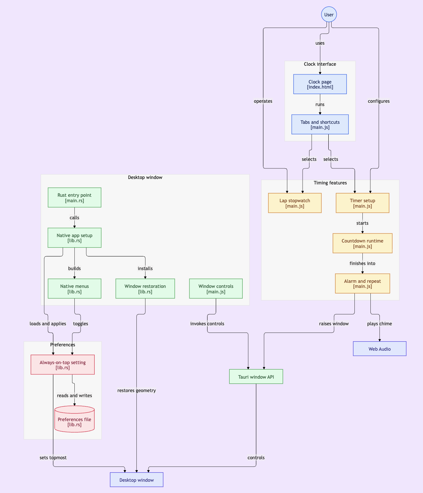

# Nook Clock

A timer small enough to live in the corner of your screen. Lap stopwatch and countdown timers, in a frameless window you can shrink down and leave there.

## Download

[Nook Clock 0.1.0](https://github.com/ernshahi/nook-clock/releases/download/v0.1.0/Nook.Clock_0.1.0_aarch64.dmg) for Apple Silicon Macs. Open the disk image and drag the app into Applications.

The build is not notarized. The first launch may need a confirmation in System Settings, then Privacy & Security. All releases are listed on the [releases page](https://github.com/ernshahi/nook-clock/releases).

## Why this exists

The default macOS Clock app covers too much of the screen, and it cannot be resized small enough to sit in a corner while you keep working. Its minimum size is already large enough to get in the way. This app exists so the timer can shrink down and stay out of the way.

The stopwatch records laps. The timer has hour / minute / second pickers, common presets, an optional label, a progress ring, and a chime that brings the window forward when time is up.

## Stack

A Tauri 2 desktop app. Rust owns the window and preferences. The timer itself is one HTML page, with no bundler.

**Rust / Tauri 2**

- Frameless, transparent window with macOS HUD vibrancy (`hudWindow`) and a 12px corner radius. Minimum size is 280×108, small enough to sit in a corner.
- Custom traffic lights wired to close, minimize, and zoom, plus a drag region on the title bar.
- Native menu bar: app, Edit, View, and Window.
- Always on Top, toggled from the View menu (`⌘⇧T`) and written to `prefs.json` with serde.
- Window size and position restored on the next launch (`tauri-plugin-window-state`).

**HTML, CSS, JavaScript**

- The page talks to Tauri through the global `window.__TAURI__` API (`withGlobalTauri`).
- Stopwatch driven by `requestAnimationFrame` and `performance.now()`. Laps record split and total, and the best and worst splits are highlighted.
- Countdown keyed to an absolute end time, so pause and resume stay accurate. An SVG ring shows remaining progress.
- Web Audio chime. When time is up the window is unminimized, focused, and asks for user attention.
- Layout that scales with the window. Type uses `clamp()`, and short heights drop laps, presets, and labels, then collapse the round buttons into compact pills.

## Run

1. Install Rust and Node.js.
2. `npm install`
3. `npm run tauri dev`

For a production build: `npm run tauri build`.

## Architecture

[Open the interactive diagram](https://gitdiagram.com/ernshahi/nook-clock)